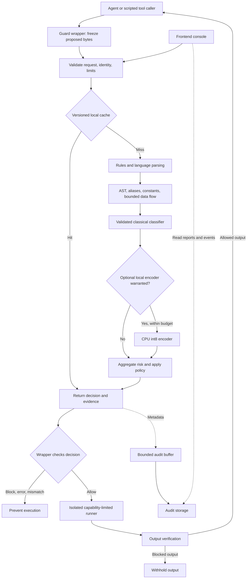

# CodeGuard frontend specification

Status: proposed design, ready to guide implementation. No frontend or detector is implemented by this document.

Based on `context.md`, `prd.md`, `README.md`, the organizer’s DOCX, all 42 records in `codeguard_dev.jsonl`, and the supplied guarded-tool-execution diagram. This document expands PRD §12 and proposes refinements; the judging contract and organizer restrictions remain authoritative. Performance numbers below are targets, never measured results.

## 1. Product direction

Build a focused security console for an engineer inspecting an agent’s proposed tool call. The opening screen should answer four questions immediately:

1. Is this call allowed or blocked?
2. Which code caused the decision, and why?
3. How long did the check take?
4. Did the wrapper actually prevent execution?

The core experience is a code editor beside an evidence panel. A compact pipeline below explains the check. Evaluation and recent decisions provide supporting evidence. Avoid a marketing landing page, chatbot, large decorative risk gauge, or an animated architecture that competes with the result.

**Runtime recommendation:** deterministic rules + AST + bounded data-flow analysis first; small classical classifier when validated; optional local encoder only if it measurably improves held-out results within the CPU latency budget. Zero generative LLM calls for detection, explanations, remediation, or frontend assistance. The upstream agent can use an LLM independently; CodeGuard does not need one to operate or demonstrate the gate.

Explanations come from rule templates populated with actual evidence. Remediation is reviewed guidance, not automatically generated executable patches.

## 2. Scope and delivery priorities

The original build is a 12-hour, two-person hackathon. The complete product below is a design destination, not a requirement to implement every page during that window.

| Delivery tier | Include | Completion criterion |
|---|---|---|
| First frontend slice | Analyze screen, verdict, original-line highlights, explanation, timing, examples, raw JSON | A real API response is legible within one screen |
| Demo evidence | Interception report panel and recorded benchmark report | Results link to actual runs and versions |
| Next iteration | Live activity, detailed data flow, output verification, rule catalogue | Backend capabilities exist and are accurately represented |
| Production roadmap | Operations page, policy editing, batch job queue, authentication, tenant controls | Load tests and access controls support the features |

Keep the judge-facing CLI interception proof and fixed-schema API working independently of the console. If backend work runs late, ship the first slice plus report viewers. Hide unavailable navigation instead of presenting working-looking mock controls.

## 3. Visual design and application shell

### Appearance

Use a restrained dark engineering console: near-black background, slate panels, thin borders, readable code, and a single blue primary action. Color represents state, not decoration.

| Token | Suggested value | Use |
|---|---|---|
| Background | `#0B1020` | App canvas |
| Panel | `#141C2E` | Editor surround and cards |
| Raised panel | `#1C2840` | Selected cards and drawers |
| Main text | `#F1F5F9` | Titles and important values |
| Secondary text | `#AAB8CE` | Labels and supporting detail |
| Action | `#60A5FA` | Analyze, links, selection |
| Allow | `#4ADE80` | Allowed decision with check icon |
| Block | `#FB7185` | Blocked decision with stop icon |
| Warning | `#FBBF24` | Degraded checks, stale data, partial coverage |

Use system sans-serif for interface text and a locally bundled monospace for code. Body text 14–16 px, labels at least 12 px, 8 px spacing grid, 8–12 px panel radii. Keep shadows subtle. Verify contrast for actual foreground/background pairs. No remote fonts or CDN assets are needed for the laptop demo.

### Layout

- Left navigation: approximately 208 px on desktop; compact drawer on narrow screens.
- Top bar: product name, environment, service readiness, active policy mode, last successful health refresh.
- Main content: fluid width; editor/result split approximately 56/44, resizable.
- Bottom status strip: language, source size, engine/rules/policy version, retention setting.
- At widths below 1024 px, stack result below the editor. Below 768 px, use tabs for Code and Result; preserve the verdict summary above both after a scan.
- On a typical 1366 × 768 laptop, the editor, verdict, reason, and first finding must appear without page scrolling.

Navigation grows only as features exist:

| Route | Label | Purpose |
|---|---|---|
| `/analyze` | Analyze | Default screen; inspect proposed code |
| `/activity` | Activity | Recent scan and enforcement events |
| `/evaluation` | Evaluation | Recorded local metrics and comparisons |
| `/proof` | Interception proof | Evidence from the controlled execution demo |
| `/rules` | Rules & policy | Read-only catalogue and active settings initially |
| `/operations` | Operations | Capacity and reliability, later |

Output verification is a mode within Analyze, not a separate primary navigation item.

## 4. Analyze: primary screen

### Desktop wireframe

```text
┌─────────────────────────────────────────────────────────────────────────────┐
│ CodeGuard        Local CPU        Ready       Policy: Enforce               │
├──────────────┬──────────────────────────────────────────────────────────────┤
│ Analyze      │ Analyze a proposed tool call                                  │
│ Activity     │ [Code check] [Tool output*]                                   │
│ Evaluation   │ [Choose example ▾] [Auto language ▾]             [Analyze]   │
│ Proof        ├──────────────────────────────┬───────────────────────────────┤
│ Rules        │ Proposed code                │ BLOCK                         │
│              │  1  import ...               │ Execution: not requested      │
│              │  2  ...                      │ Risk 0.94 / 1 · Python        │
│              │  3  ... [source highlight]    │ Credentials reach a network   │
│              │  4  ...                      │ request on lines 3–7.         │
│              │  5  ...                      │ [Secret access] [Exfiltration]│
│              │  6  ...                      │                               │
│              │  7  ... [sink highlight]      │ Findings | Flow | Timing | JSON│
│              │                              │ Finding with evidence + fix   │
│              ├──────────────────────────────┴───────────────────────────────┤
│              │ Validate → Cache → Rules → Structure → Policy → Result      │
│              │ Server: measured value   Round trip: measured value         │
└──────────────┴──────────────────────────────────────────────────────────────┘
* Only appears when the output verification endpoint is available.
```

The score and code above are illustrative layout content. Never ship them as live telemetry.

### Input behavior

- CodeMirror 6 editor with line numbers, syntax highlighting, search, accessible navigation, and a plain-text fallback.
- Default action: **Analyze**. `Ctrl/Cmd + Enter` submits. No execution button in the playground.
- Auto-detect language server-side; optional language hint is advisory and must not bypass analysis. Show hint and detected language separately when they disagree.
- Show UTF-8 byte count and the configured input cap (PRD default 256 KB). Reject oversized uploads before submission and enforce the limit again server-side.
- Accept pasted text and a single local text file. File contents are analyzed, never imported or run.
- Preserve exact submitted text for line mapping. Keep its snapshot for each result.
- Examples include malicious and benign look-alikes. Display their fixture labels separately from predictions, after a scan or in an explicit “Show expected label” section.
- Manual submission by default. Optional analyze-on-pause can follow later with a 600–800 ms debounce, one request in flight, cancellation, and rate limiting.
- Edits immediately mark the previous result “For an earlier revision.” Clear active line highlights until a result matches the current snapshot. A late response cannot replace a newer result.
- Retain editor content in memory only by default. Do not put code in URLs, analytics, local storage, or shared browser caches.

### Result hierarchy

1. **Verdict:** ALLOW or BLOCK from the backend.
2. **Execution:** separate wrapper-reported status: Not requested / Prevented / Executed / Unknown. A playground scan always says “Not requested.”
3. **Reason:** one or two readable sentences with original source lines.
4. **Risk:** numerical `0.00–1.00` score with a small horizontal meter and policy threshold marker. Label “Risk score”; never “probability of attack.”
5. **Categories:** all returned categories, with readable labels and exact API enum on hover/copy.
6. **Latency:** server processing and browser round trip shown separately.
7. **Evidence:** finding cards and deeper tabs.

For ALLOW, say “Allowed under the active policy.” For a no-finding case, say “No blocking findings in the completed checks.” Show coverage limitations alongside the result when applicable.

For an engine timeout or overload: “Execution blocked because the check could not complete.” The UI must distinguish a security finding from a fail-closed operational decision even when both use API verdict `block`. Do not invent a malicious category for infrastructure failure.

### Finding cards

Each finding shows category, severity, rule ID, original line range, and concise what/why/impact/remediation fields. Evidence is redacted before being sent as retained detail. Rule confidence, if available, is labeled separately from risk.

Clicking a card scrolls to and highlights its source lines. Multiple findings on one line share a gutter marker with a count. Unknown line attribution is shown as “Location unavailable”; never use line zero or guess a line from model output.

Offer expandable CWE / ATT&CK / ATLAS references, and “Copy explanation” and “Copy redacted result.” A future false-positive feedback action records a report; it does not silently change policy.

### Evidence tabs

| Tab | Content | Behavior when unavailable |
|---|---|---|
| Findings | Rule cards, evidence, remediation | Show backend reason as the basic fallback |
| Data flow | Source → transformations → sink; actual line links | “No structured trace available” |
| Analysis | Parser status, alias resolution, bounded decoding, coverage | Mark unreported stages unknown |
| Timing | Current request timings and stage statuses | Show round trip only if server timings absent |
| JSON | Validated response, request ID, versions | Render as escaped text; redact export by default |

The data-flow view should explain, for example, “Credential file → parsed dictionary → POST body → untrusted destination.” Use a simple vertical sequence first. A graph library is unnecessary until traces branch enough to justify it.

AST detail is an expandable engineering view: canonical call names, resolved constants, source/sink nodes, guard recognition, and limits reached. Show `o.system` resolved to `os.system` when that resolution actually occurred. An alias alone is not a vulnerability.

Decoded payloads belong in an inert, bounded preview. Their findings link to the original expression lines, not fabricated lines in the submitted file.

### Pipeline display

Each stage reports one of completed, cache hit, skipped, unavailable, failed, or not reported. A skipped encoder is normal. A model-only finding must not masquerade as an AST trace.

Animate only the pending request indicator. Millisecond checks finish too quickly for a believable staged live animation; render actual stage results after completion. Do not add delay for visual effect.

## 5. Tool-output verification mode

This mode checks text before it returns to an upstream agent. Input is labeled “Tool output,” with optional source metadata. Show the output decision and two separate facts: suspected instructions and secret spans.

- Highlight instruction and secret spans in escaped plain text.
- Keep original output local to the active session; mask secrets in evidence and exports.
- Show a redacted preview only if the backend provides one.
- Use “Copy redacted preview,” not “Make safe” or “Approve output.” Removing detected text is not proof that the remaining text is safe.
- For blocked output, the wrapper withholds it. A future sanitized-release workflow requires its own defined verification and policy decision.
- Render HTML, Markdown, terminal escapes, URLs, and code as untrusted data. No active previews, automatic URL fetching, or external resource loading.
- Proposed span contract: half-open offsets `[start, end)` in Unicode code points against the exact original text. Convert to JavaScript UTF-16 editor offsets explicitly; test emoji and CRLF handling. This coordinate convention must be agreed with the backend before implementation.

## 6. Activity and request details

Activity shows recent decisions from real events, newest first. It is an observability view, never the mechanism that grants execution permission.

Columns: time, request ID, source/tool, language, verdict, enforcement outcome, risk, categories, server latency, cache status, and degraded status. Filters: time range, verdict, category, language, source, and degraded-only. Support cursor pagination; virtualize long lists.

Click a row to open a drawer with reason, rule IDs, versions, timings, and correlated wrapper events. Raw code is unavailable unless explicitly retained under a separate policy. Say “Source was not retained” instead of showing an empty editor.

Use an authenticated SSE stream or the PRD’s Supabase Realtime channel, selecting one transport rather than operating both. Reconnect with backoff, deduplicate by event ID, and resume with a cursor. On a gap, refetch recent records and label missing history. Show “Disconnected; last update …” when stale. A pause-feed toggle pauses rendering only.

Suggested event lifecycle: `scan_received`, `scan_completed`, `execution_prevented`, `execution_started`, `execution_completed`, `output_checked`. Events come from the responsible service or wrapper; the frontend never infers “prevented” from `block` alone.

Audit delivery is eventually consistent and may lose records under the PRD’s best-effort design. Dashboard counts from an audit sample must be labeled as such; aggregate throughput and loss counters come from metrics.

## 7. Evaluation

Display recorded local evaluation results, not an official hidden-test score. The public sample contains 42 snippets: 30 malicious, 12 benign; 36 are Python. That small, uneven sample cannot establish broad language coverage or production accuracy.

### Report layout

- Run selector with dataset name/hash, sample count, date, engine/rules/model/policy versions, threshold, CPU model/core count, RAM, and concurrency.
- Summary: precision, recall, F1, false-positive rate, and raw confusion counts.
- Per-category table across all nine categories, showing support as well as precision/recall/F1.
- Binary confusion matrix and inspectable false-positive/false-negative rows.
- Multi-label macro/micro F1 separately from binary allow/block performance.
- Warm/cold latency p50/p95/p99, cache status, encoder usage, and errors.
- Baselines A–E from the PRD: keywords; structure; structure + classical ML; optional encoder; offline external reference tools. Unavailable baseline means “Not run.”

Metrics with zero denominators are N/A. Show numerator/denominator and uncertainty where supported. One false positive among 12 benign examples is already 8.33%, so a ≤5% FPR target requires zero false positives on this particular sample; it does not establish a ≤5% population FPR.

Separate the public tuning/regression set from held-out evaluations. Group mutations of a seed in the same split. Record the split protocol and any tuning history in report metadata. Never count matching a cached public sample as evidence of unseen-code performance.

For latency comparisons, use the same machine, dataset, concurrency, versions, and cache configuration. Show uncached engine performance independently of realistic repeat-request cache performance.

First implementation imports a recorded report. Later, “Run evaluation” submits bounded work to a dedicated evaluation worker. Labels stay in the evaluation system; the detector receives code without expected answers. The frontend displays progress but never executes snippets.

## 8. Interception proof

Display the last report from `demo/intercept_check.py`. The CLI remains the live judge-facing proof.

| Test | Evidence required |
|---|---|
| Organizer safe case | Allowed; executor entered; expected marker present |
| Organizer unsafe case | Blocked; executor call count zero; unsafe marker absent |
| Negative control | Harness detects a deliberately simulated bypass and reports the expected failure |
| Guard failure | Timeout/invalid response prevents executor entry |

Show run ID, timestamp, pair identity/hash, environment, wrapper version, actual assertions, and captured plain-text log. Overall “Proof passed” appears only when the necessary assertions pass. An expected negative-control failure must be clearly labeled as successful detection by the harness.

Until the organizer supplies the pair, show “Awaiting organizer demo fixtures.” Do not substitute executable dataset attacks. The initial UI imports or reads reports; a future demo trigger accepts only registered fixture IDs in a local restricted harness, never editor text, commands, paths, or uploaded executables.

## 9. Rules, policy, and coverage

Start with a read-only page driven by `/v1/rules` and `/v1/policy`. Show active policy version, threshold, mode, category coverage, parser availability, size/depth/time limits, and allowlist names.

| API category | UI label |
|---|---|
| `secret_access` | Secret access |
| `data_exfiltration` | Data exfiltration |
| `destructive_command` | Destructive operations |
| `persistence_or_privesc` | Persistence / privilege escalation |
| `obfuscated_execution` | Obfuscated execution |
| `dependency_risk` | Dependency risk |
| `resource_exhaustion` | Resource exhaustion |
| `ssrf_network_exfil` | SSRF / internal network access |
| `ai_targeted_instructions` | AI-targeted instructions |

Coverage must distinguish Python AST/data flow, Bash command parsing, SQL structure, JS parser or token fallback, and YAML/Markdown text/embedded-command checks. Never label token fallback “Full AST coverage.” Unknown-language or incomplete analysis appears explicitly in results.

Use Enforce throughout the controlled demo. Future Monitor mode is prominent: “Observe only; security blocks may not prevent execution.” Define wrapper behavior explicitly; operational failures still fail closed. Do not provide a one-click “Run anyway” action.

Production policy editing needs authorization, validation, a reviewable diff, versioned activation, and audit. Policy changes invalidate decision caches. This is later scope, not a browser-only settings form that merely changes displayed thresholds.

## 10. Refined architecture inspired by the supplied image

The image correctly places a gate before tools and isolates execution. Refine its “sanitized inputs” block into input validation plus structural inspection: arbitrary code cannot be made safe by stripping suspicious strings. Keep the original code unchanged so the decision binds to exactly what the wrapper would execute.



The console’s scan path ends at its result. It has no general route to the runner. The detector, enforcement wrapper, and sandbox have different responsibilities; show their states separately.

“No raw shell” means tool access is through registered capabilities and validated arguments, with process invocation avoiding shell interpolation where possible. If an authorized shell capability exists, describe its restrictions accurately. “No network” applies to the detector’s analysis and the controlled runner’s egress policy, not to browser/API or audit transport. Production tools may need explicit destination-bound egress controls.

Destination parsing is static and makes no DNS/HTTP requests during analysis. Actual DNS resolution, redirects, and runtime egress need enforcement at the executor/network boundary. A URL allowlist alone cannot prove the final network destination is safe.

## 11. CPU performance, caching, queues, and scaling

### Detection design that supports the interface

Load parsers, compiled rules, package reference data, and selected models once at startup. Readiness follows warm-up. Parse once per language segment and share bounded intermediate results across checks. Preserve comments and strings for injection detection. Bound AST nodes/depth, decoded bytes, recursion, and source size.

Resolve aliases and constants and track source-to-sink flows. Treat guards as context-specific: `shlex.quote` is not a universal sanitizer; parameterized SQL protects values, not arbitrary identifiers; string-prefix URL tests do not establish a valid host allowlist. Show recognized guards only when their relevant control-flow and sink constraints are satisfied.

Start with Python depth because of the dataset distribution. Keep other-language coverage honest. Avoid claiming cross-file analysis or complete path sensitivity. A classifier can contribute a bounded signal, but cannot override a critical structural finding.

The existing 30–125M encoder proposal is optional, not a baseline dependency. A CPU-only pipeline can ship without it. Adopt it only after held-out benefit, memory footprint, p95 latency, and gray-zone invocation rate are measured. Do not truncate away unchecked content and then display “Full scan completed.”

### Cache recommendation

Use an in-process, bounded LRU/TTL cache first. It avoids a remote dependency and is likely sufficient for the laptop and early replicas. Cache both allow and block decisions only after complete, non-degraded analysis.

Key a deterministic serialized tuple containing:

```text
SHA-256(exact submitted bytes)
+ endpoint/check kind
+ language hint and every decision-relevant context field
+ tenant/security scope
+ engine, parser, rules, model, and policy versions
+ analysis configuration and output-sanitization mode
```

Do not use an AST-only or whitespace-stripped key: comments can carry injection and source offsets can differ. Enforce authentication and limits before cache access. Policy/model updates create new namespaces; TTL is only a memory/freshness bound, not the primary invalidation mechanism.

- Bound entries and bytes; start with a measured memory budget, such as 32 MiB per worker, and tune.
- Do not cache timeouts, overload responses, partial analyses, or transport errors.
- Cache immutable analysis payloads, not request IDs, trace IDs, audit events, signatures, or current request timings.
- Every cache hit gets its own request ID and audit event. Show current cache lookup/server latency separately from original analysis timing.
- Store minimal/redacted evidence and account for its sensitivity even in memory.
- A future single-flight optimization can coalesce identical concurrent scans within the same scope; bound waiters and preserve individual deadlines.
- Add shared Redis caching only if measured reuse across replicas outweighs network latency and complexity. It is an optional acceleration: outage becomes a cache miss, never permission to execute.

### Queue recommendation

Keep `/v1/guard` synchronous. A proposed tool call must obtain its verdict before execution. A durable job broker on every scan would introduce waiting and another failure dependency.

| Work | Approach | Failure behavior |
|---|---|---|
| Live guard requests | Warm workers, bounded admission/in-flight capacity | Reject overload promptly; wrapper fails closed |
| Audit writes | Bounded local buffer, batched background writes | Count drops/retries; show audit degradation |
| Existing small batch endpoint | Bounded per-item processing and deadlines | Per-item result; no change to its response contract |
| Large evaluation jobs, later | Separate durable queue and worker pool | Job status, retry bounds, cancellation, per-item progress |
| Metrics/UI events | Bounded delivery with aggregation | Stale/gap indicators; never controls execution |

Admission queue wait consumes the total deadline. Do not allow an unbounded pool queue to hide overload. Client-side cancellation alone does not stop CPU work; workers need cooperative deadlines and isolation for parser calls that cannot be interrupted safely. Use reusable worker processes where needed, not a process launch per scan. A timed-out stuck worker must be recyclable.

An async evaluation API is an additional job API, not a replacement for `/v1/guard/batch`. Use idempotency keys for job creation, at-least-once-safe result writes, and bounded retries. Canceling a job stops pending items and requests cancellation of active analysis; it never triggers snippet execution.

The initial best-effort audit buffer can lose records on crash or overflow. Display that limitation. If durable audit-before-execution becomes a production requirement, design and measure an explicit durable acknowledgement path; do not claim guaranteed traceability from a best-effort queue.

### Scaling and operations view

Use a bounded process count matched to CPU and memory. Pure Python AST work does not become parallel merely by adding async handlers or thread-pool tasks. Avoid multiplying API worker counts, process pools, and ONNX threads into CPU oversubscription. Start with one analysis process per allocated core and tune from measurements.

Separate live scan capacity from evaluation capacity. Keep at least one warm replica locally/for judging; production can start at two or more where deployment supports it. Autoscaling is delayed, so warm headroom and overload control handle bursts while replicas start.

Operations displays measured request rate, in-flight requests, admission wait, CPU, RSS memory, ready replicas, p50/p95/p99, cache hit rate, degraded/error rate, encoder invocation rate, audit depth, audit drops, and batch backlog. Each metric shows its window and last refresh. Readiness is different from process liveness.

Use measured concurrency/CPU saturation to select autoscaling thresholds. Estimate capacity as `workers / mean_service_seconds × utilization_headroom`, then validate under realistic load; do not promise a fixed RPS from architecture alone.

Targets inherited from the PRD for snippets ≤4 KB: fast-path server p50 ≤5 ms and p95 ≤25 ms; optional encoder p95 ≤100 ms. These exclude browser rendering and network round trip. Benchmark larger sizes separately. Show targets beside measurements only when both are labeled.

## 12. Frontend/backend contracts

Preserve the strict judged response with `verdict`, `risk_score`, `categories`, `code_language`, `reason`, and `vulnerable_lines`. Use `POST /v1/guard?detail=full` for the console’s richer response. Validate responses at runtime, not just through TypeScript types.

| UI feature | Existing PRD interface | Additional work needed |
|---|---|---|
| Analyze | `/v1/guard?detail=full` | Source snapshot binding in client |
| Output mode | `/v1/verify-output` | Agree span coordinates and release semantics |
| Readiness | `/healthz`, `/readyz` | Version/capability metadata, proposed |
| Rule/policy view | `/v1/rules`, `/v1/policy` | Editing API is later scope |
| Evaluation | `/v1/guard/batch` and recorded reports | Report reader/importer; async jobs later |
| Activity | Audit storage | Authenticated read/event interface |
| Proof | CLI artifact | Versioned report schema/importer |
| Operations | `/metrics` | Authorized aggregate JSON adapter; do not expose raw infrastructure data publicly |

Proposed optional detail fields: `policy_version`, `model_version`, `cache_status`, `analysis_complete`, `coverage`, `stage_status`, and structured `data_flow`. These are proposals, not fields guaranteed by the current PRD. The client must degrade gracefully when absent.

Use request IDs to join scan and wrapper events. A future signed decision must bind exact code, relevant tool arguments/context, policy version, tenant, expiry, and a request nonce; signature verification belongs in the wrapper, not the frontend. Audit evidence is not an execution authorization token.

Handle 400 with inline validation, 413 with a size message, 429 with a retry hint, and network/schema failures as “Analysis unavailable.” A browser with no valid response cannot claim a server BLOCK; it can explain that an enforcing wrapper must prevent execution. Valid fail-closed server responses retain their returned BLOCK plus degraded reason.

## 13. Frontend implementation approach

Recommended stack: React + Vite + TypeScript, Tailwind with CSS variables, CodeMirror 6, and a small chart library such as Recharts loaded only on Evaluation/Operations. Use native fetch plus AbortController initially; add TanStack Query when multiple server-driven views warrant it. No browser model, Python runtime, or duplicate security engine.

Suggested components:

```text
console/src/
  app/             routes, layout, capability availability
  api/             client, runtime schemas, event subscription
  features/analyze/ editor, verdict, findings, flow, timings, JSON
  features/activity/ feed, filters, request drawer
  features/evaluation/ report import, metrics, confusion table
  features/proof/   report viewer
  features/rules/   catalogue, policy summary
  features/operations/ metric panels
  components/      status badge, empty state, accessible tabs
  styles/          tokens and layout
```

Lazy-load charts and optional editor language packs. Bound rendered source/output previews and virtualize long feeds. Aggregate event updates on a short interval instead of rerendering the editor for every audit record. Serve bundled assets locally so the demo works without CDN access.

Use same-origin API routing where possible. Never bundle service-role credentials or persistent API secrets into browser code. For a laptop demo, bind to local access with fake fixtures. Public/production deployment needs authentication, authorization, tenant-scoped reads, rate limits, restricted CORS, and retention controls before it exposes scan history or administrative actions.

## 14. States and accessibility

| State | Display / behavior |
|---|---|
| Empty | “Paste code or choose an example to analyze.” |
| Loading | One pending indicator, elapsed round trip, no invented verdict |
| Completed | Backend verdict and available evidence |
| Edited since scan | Stale-result label; old verdict clearly tied to old snapshot |
| Parse/coverage gap | Exact completed/omitted checks and backend policy outcome |
| Model disabled | “Optional encoder disabled”; no health alarm unless required |
| Disconnected | Last known result labeled stale; retry available |
| Audit unavailable | Scan remains usable; activity warns of delayed/missing events |
| No report | “No evaluation/proof run recorded.” |
| Unsupported capability | Hide action or explain unavailable backend feature |

Use icons and text alongside color. Support keyboard submission, tab navigation, editor escape, focus-visible styles, and finding-to-line navigation. Announce verdict changes through a polite live region without rereading all code. Honor reduced motion. Provide text tables for every chart and readable plain-text alternatives to diagrams.

## 15. Demo narrative and acceptance checks

A short demo should proceed as follows:

1. Analyze a benign look-alike, such as parameterized SQL, to demonstrate context-aware allowance.
2. Analyze a source-to-sink example and show its real category, line attribution, and explanation.
3. Analyze an alias/obfuscation or AI-directed comment example to demonstrate structural/text coverage.
4. Repeat a scan to demonstrate a real cache hit and its current latency, if caching is implemented.
5. Show the organizer-pair interception report and the live CLI proof.
6. Show a recorded evaluation with failures, baseline comparisons, CPU details, and measured latency.

Acceptance checks for the implemented frontend:

- Valid allow/block responses render all required fields and all returned categories.
- Selecting a finding highlights the correct original lines, including CRLF and decoded-content mappings.
- Editing or out-of-order responses cannot attach an old verdict to new code.
- Cache hits preserve findings while getting fresh request metadata and truthful timing.
- Operational blocks are visibly distinct from detected threats; offline UI never fabricates a verdict.
- A scan result alone never displays “execution prevented.”
- Malicious HTML/Markdown/terminal text renders inertly and cannot leak through analytics or remote previews.
- Unsupported detail fields, empty reports, disconnected feeds, and audit gaps have useful states.
- Evaluation distinguishes labels from predictions, handles N/A metrics, and identifies cache/tuning conditions.
- The controlled proof is fixture-bound; no editor or dataset code can reach its executor.
- Keyboard use, narrow layouts, contrast, and reduced motion are verified.

The first implementation should deliver a clear answer, traceable evidence, and honest execution status. More charts and infrastructure controls follow only when the backend can substantiate them.
